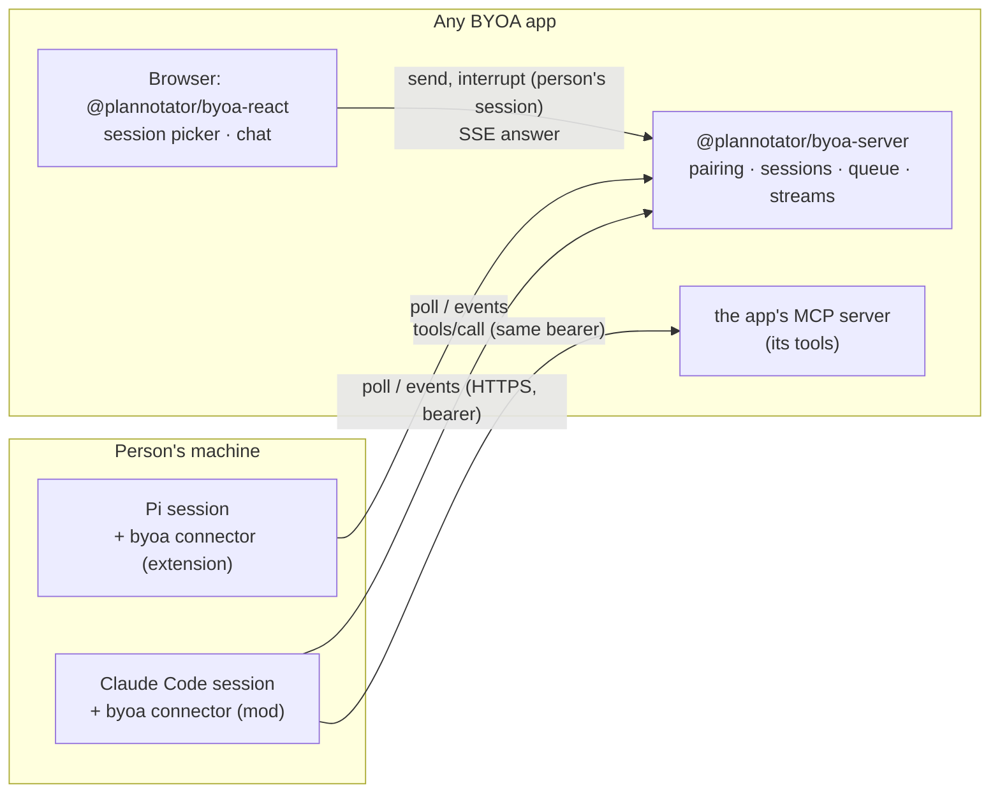

# BYOA: Bring Your Own Agent

Draft, 2026-10-21. Concept and design. The wire is in [SPEC.md](SPEC.md); the research behind both is in [research/](research/).

## The idea

A web app lets you use the coding agent you already run on your own machine (Claude Code, Pi, OpenCode, Amp) as that app's agent. You connect your agent once. After that, the app's chat panel talks to your running session, your session uses the app's tools, and the app can hand it work. The app runs no model and pays for no inference. The agent keeps your setup: your model, your plugins, your repo, your permissions.

Today each app that wants this builds it alone. BYOA makes it three pieces anyone can use:

- **an app SDK** a web app mounts on its server, plus a chat component for its UI;
- **a small HTTP wire** between the app and the agent;
- **one connector per agent**, installed once, that connects that agent to any number of BYOA apps.

## Why the standards don't deliver this yet

Checked against current sources on 2026-10-21 ([research/12-standards-amp-priorart.md](research/12-standards-amp-priorart.md)).

| | What it does | Why it is not BYOA |
| --- | --- | --- |
| MCP 2026-07-28 | Gives an agent an app's tools. | A server cannot start a turn. `subscriptions/listen` carries only list-changed notices. Stand-alone server-to-client requests are now forbidden, and sampling is deprecated. Events (SEP-3415) is a draft that delivers to the client, not to the model. Turn-starting push (SEP-2495) has stalled. 2 of 22 clients run 2026-07-28; Claude Code does not. |
| MCP Apps | Renders an app's UI inside the agent's chat. | The opposite direction. BYOA puts the agent inside the app's UI. Claude Code does not support it. |
| WebMCP | A page registers tools for a browser agent. | No page-to-agent prompt; autonomy is a non-goal. A terminal agent reaches it only through a relay. |
| ACP | An editor spawns an agent subprocess and drives it. | It starts a new agent process, not the session you already run with your plugins and context. A browser cannot spawn processes. HTTP transport and agent-initiated work are open RFDs. |
| Claude Code channels | An MCP server pushes into a Claude Code session. | Research preview, allowlisted plugins only, a `--channels` flag per session, stdio only, no acknowledgement. One host. |
| Remote Control, Happy, claudecodeui | Drive your session from a browser or phone. | A remote terminal, not an app's agent. They don't give the agent any app's tools. |

The agents' plugin systems already have what MCP lacks: a plugin can register tools, start a turn in an idle session, and watch the turn stream. Claude Code mods (`$.prompt.submit`, `turn.step`), Pi extensions (`sendMessage` with `triggerTurn`, `message_update`), OpenCode 2 plugins (`session.prompt`, `event.subscribe`), and Amp plugins (partly: `appendUserMessage`, `agent.end` continue). BYOA builds on those, and moves to a standard transport when one ships.

## What four implementations on this machine already proved

Four sessions on this machine built this pattern for four products, separately, in the last three weeks:

| | Workspaces | Plannotator Inbox | AppNotes | Machine |
| --- | --- | --- | --- | --- |
| Shape | hosted, chat | local, async replies | hosted, work queue | local or hosted, designer chat |
| Agent dials out, long-poll | yes, 20 s hold | yes, 25 s | yes, 30 s poll | yes, 25 s |
| Pairing | device code | loopback token file | existing MCP OAuth | `machine login` key file |
| Turn starts when idle | yes | yes | yes | yes |
| Events back | 9 types, `seq` | delivered ack | run report | turn start/end |
| Tools | host MCP client | one proxied tool | MCP tools | one proxied tool |
| Hosts | CC, Pi, OC2 | CC, Pi, OC2 (+MCP fallback) | CC, Pi, OC2 | CC, Pi, OC1/2 (+ACP) |

They agree on almost everything:

1. **The agent always dials out.** Claude Code mods cannot listen on a port, and `$.http.fetch` aborts at 30 s. So every app holds a long-poll for about 20 s.
2. **A message becomes a turn only when the session is idle.** Each host has its own call: `$.prompt.submit`, `sendMessage({ triggerTurn, deliverAs: "followUp" })`, `session.prompt({ delivery: "queue" })`. Three of the four never put an app's message into a running turn. Plannotator does only when the person presses Send now, and Workspaces turned it off after a hand-off joined a busy session's turn.
3. **Deliver once.** Every one hit duplicate delivery: two processes on one session, a lost poll answer. Each command carries an id, and the agent acts on it once.
4. **Only the person starts a turn.** No API key, run key, or teammate can put text into someone's terminal agent.
5. **The server writes the turn text, with ids rather than content.** One implementation's contract review found that a document path a teammate named could carry an injection into the turn text.
6. **Interactive sessions only.** Every one had `-p`, RPC, or SDK runs registering by mistake.

The hard parts are the same too, and they live in the agent-side adapter:

- Claude Code's `/clear` changes the session id with no event.
- A prompt the person types into an app's turn joins it, and its answer must not stream to the app.
- Pi retries end a turn twice.
- OpenCode's queue and steer behave differently.
- Subagents look busy.
- A changing tool list breaks the prompt cache.

A review of Workspaces' extensions by the Plannotator session found nine of these at once, all fixed in one PR. AppNotes copied Workspaces' and Plannotator's code to avoid them. **Four apps × three hosts is twelve adapters carrying the same fixes.** That is the cost BYOA removes.

## Design



### Decisions, and why

1. **One connector per agent, not one per app.** The person installs `byoa` once in each agent (`/plugin install byoa`, `pi install npm:@plannotator/byoa-pi`, `opencode plugin add @plannotator/byoa-opencode`) and connects it to each app with `/byoa connect <url>`. The turn tracking, the take-over rule, `/clear` and retries get written and fixed once per host. Apps implement only the server side. Apps that want their own branded plugin build it from the same core library, and it speaks the same wire.
2. **Long-poll is the only transport.** It works on the most constrained host, behind any proxy, and on serverless platforms (Workspaces runs it on a Durable Object). An app without a place to hold a request can answer at once and have the connector poll every few seconds. One connector holds one poll per app at the same time; that was measured in real Claude Code (SPEC 2).
3. **Tools stay MCP.** The app's existing MCP server accepts the connection token. The connector exposes it as one proxied tool per app, built from `tools/list` at session start, so the tool list stays fixed for the session and needs no restart. One credential covers both the wire and the tools, so the app can tie a tool call to the session and message that made it (SPEC 7).
4. **The app writes the turn; the connector labels it.** The app's server composes the turn text, as today. The connector adds the first line, `[BYOA] <App> (<origin it paired with>) · chat from <person>`, so an app cannot pretend to be another app or the person. Apps drop their own prefix, so the person sees one label. This matters once one agent is connected to several apps: Claude Code's own label names only the `byoa` plugin.
5. **Only the app's own turns leave the machine.** The connector streams answer text and tool names for turns that app's messages started. It never streams thinking, tool input or output, subagent steps, or anything after the person types into the turn.
6. **One connector setting: what is shared.** Per app, the person chooses which folder details are sent (default: folder name and git remote, never the path). The connector enforces it. Nothing else is configurable in 0.1.
7. **Presence comes from polls.** `ready`, `busy`, `blocked` (a permission prompt is up), and `gone` after 60 s without a poll. When the state changes, the connector polls again at once, so the app sees a turn start as it starts. No heartbeat, no separate event.
8. **One pairing grant.** A device code following RFC 8628, as Workspaces does, for hosted and local apps alike. A local app serves its approval page on its loopback origin.
9. **A message waits for idle.** It never enters a running turn. Steer and "send now" are left for 0.2.

### What it looks like to use

App server (sketch of the intended SDK, not built):

```ts
import { createByoa } from "@plannotator/byoa-server";

const byoa = createByoa({
  app: { name: "Workspaces", origin: "https://workspaces.example" },
  authenticate: (req) => getSignedInUser(req),        // the app's own session
  store: durableObjectStore(env.BYOA),                 // or memoryStore(), postgresStore(db)
  mcp: { path: "/mcp" },                               // existing MCP server; accepts BYOA tokens
});

app.all("/.well-known/byoa", byoa.handle);
app.all("/byoa/*", byoa.handle);

// Hand-off from app code, with no browser in the loop:
await byoa.enqueue(user.id, sessionId, { kind: "task", text: handoffFrame(workspaceId) });
```

App UI:

```tsx
<ByoaChat sessions={useByoaSessions()} context={{ documentId }} />
```

The person:

```
/plugin install byoa          # once per agent
/byoa connect workspaces.example
  → open https://workspaces.example/byoa/connect, enter BCDF-GHJK
  → Connected to Workspaces as Ramos.
```

### The toolkit

| Package | What it is | Seed |
| --- | --- | --- |
| `@plannotator/byoa-protocol` | JSON Schemas and types for the wire, golden fixtures | SPEC.md |
| `@plannotator/byoa-server` | A fetch-API handler for discovery, pairing, sessions and UI doors; store adapters (memory, Durable Object, Postgres or Redis) | Workspaces, Machine |
| `@plannotator/byoa-react` | Session picker, chat, Stop, and a transport that maps events to AI SDK UI parts | Workspaces |
| `@plannotator/byoa-connector-core` | Host-free core: pairing client, credential file, door client, backoff, the per-message turn state machine, policy | Workspaces, Plannotator |
| `byoa` (Claude Code), `@plannotator/byoa-pi`, `@plannotator/byoa-opencode` | Host adapters | the twelve adapters on this machine |
| `@plannotator/byoa-amp` | Experimental. Amp can register tools and append a user message, but it is unverified whether an outside event can start a turn in the current thread. | Amp plugin docs |
| `@plannotator/byoa-mcp-fallback` | A stdio MCP server with a `wait_for_message` tool for hosts with no plugin system (Codex, Cursor, Gemini). It never wakes the agent; it only shows the agent's tools. | Plannotator's `inbox mcp` |
| `@plannotator/byoa-conformance` | A fake host and a fake app, a scripted clock, and the cases in SPEC 10 | Machine, Workspaces |

## Security

What connecting grants: the app can start turns in your agent with your permissions, and the agent can use the app as you. SPEC 9 is the full list. The four that carry the design:

- **A person starts every turn**, by an action in their own signed-in session. No credential, including the connection's own, can send, and no scheduled automation either. So there are no loops and no teammate injection.
- **The host's permission prompts are the control.** The connector never answers them. A session that skips them acts on whatever it reads. Setup says so plainly.
- **The connector names the source of every turn**, and the person can always see it in the terminal.
- **Revoke from either side.** Disconnect in the app, or `/byoa disconnect` in the agent, ends polls at once.

The new risk a universal connector adds is that one session serves several apps. Text that app A returns through a tool can steer the agent into calling app B's tools. Sometimes that is what the person wants (Workspaces asks, the agent files it in Linear), but it is also a path for injection between apps. Pi asks no permission by default, so on Pi nothing stops it. None of the four implementations faced this, because each serves one app. Draft 0.1 requires (SPEC 9.6 and 9.8):

- one app turn at a time per session;
- a tool list fixed at session start;
- tokens sent only to their own origin.

It does not scope a turn to its own app's tools: the owner chose to allow cross-app use and rely on permission prompts (Decisions, 3).

## Decisions

Decided by the owner in the Plannotator Inbox, 2026-10-21:

1. **One universal connector per agent.** Each app does not ship its own plugin. Apps that want a branded plugin can still build one from `@plannotator/byoa-connector-core`.
2. **Home and licence.** A Plannotator open-source project. The repo lives only in the `plannotator` GitHub org (`plannotator/byoa`), packages publish as `@plannotator/byoa-*`, and the licence is `MIT OR Apache-2.0`, as Workspaces and Plannotator use.
3. **Cross-app tool use is allowed.** One app's turn may use another connected app's tools, and the agent's permission prompts are the control. Connector setup states the consequence: a session that skips prompts, or Pi with its default of no prompts, acts on what any connected app returns.
4. **Machine migrates first.** It is the fastest proof of the wire.

Still open: a hosted relay, like Pusher for agent sessions, so a static or serverless app can add BYOA without holding long-polls itself. That would be a product, not part of the protocol.

## Where this goes next

- **Standards watch.** If MCP SEP-3415 (events) or ACP v2's agent-initiated prompts with HTTP transport land and Claude Code adopts them, the connector's transport changes and the app side does not. Write BYOA up as a proposed MCP extension once the 0.1 wire has run in two apps.
- **Claude Code mods' authoring contract may spread.** Qwen Code is building a compatibility layer on it (QwenLM/qwen-code#13749). If it spreads, one mod adapter covers more hosts.

## Check

[REVIEW.md](REVIEW.md) records two rounds with the four implementing sessions. In round 1 they reviewed whether their product could run on this wire. In round 2 they voted keep or cut on every decision, with evidence from their code. Round 2 cut nine features. The one bottleneck nobody had evidence on, one connector holding a poll per app at the same time, was measured in a real Claude Code session ([research/30-fetch-concurrency-probe.md](research/30-fetch-concurrency-probe.md)).
